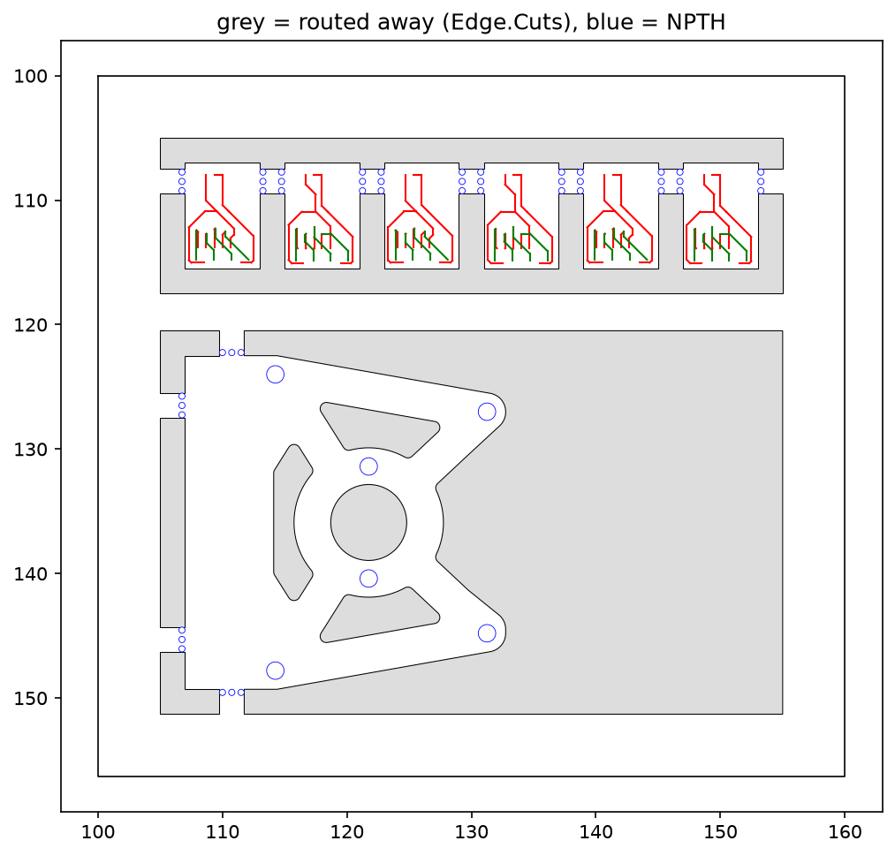
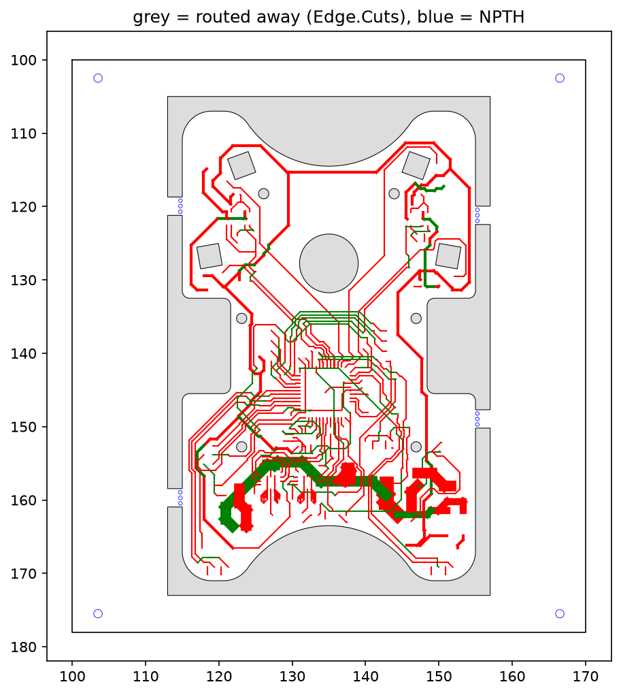

# 発注用パネル

発注は 2 つ。同じカートに入れれば 1 回で発注・発送できる。

| 注文 | ファイル | PCBA |
|---|---|---|
| メイン基板 | `TORANEKO.Mk3_main_panel.kicad_pcb`（下記「メイン基板パネル」） | Standard PCBA（抵抗・コンデンサ・IC など 65 個） |
| エンコーダ基板 ×6 ＋ 上部固定基板 | `TORANEKO.Mk3_panel.kicad_pcb` | なし（C26・C27 は手はんだ） |

## エンコーダ基板 ×6 ＋ 上部固定基板 ×1

エンコーダ基板（6 × 8.5 × 0.6mm）6 枚（IC5 側 ×3、IC7 側 ×3）と、上部固定基板（25.75 × 26.8 × 0.6mm、銅箔なし）1 枚を並べた発注用パネル。メイン基板とは別の注文で出す。



| 項目 | 値 |
|---|---|
| パネル寸法 | 60 × 56.3mm（枠 5mm、基板間・枠との隙間 2mm、上下の段の間に幅 3mm の桟） |
| ミシン目 | NPTH Φ0.5mm、ピッチ 0.75mm、1 か所 3 穴。穴は基板の外側（タブ側）に置き、折ったあとの残りは基板の外に出る |

## エンコーダ基板（上の段）

| 項目 | 値 |
|---|---|
| 基板の固定 | 左右の辺のタブ（上端から 0.5〜2.5mm、幅 2mm）＋ミシン目 |
| はんだ付けする辺（下辺） | タブなし。ルーターで切るのできれいな辺になる |
| 上辺 | タブなし（AS5047P のパッドまで 0.22mm しかないため） |

- ミシン目の穴から銅箔までは 0.8mm 以上
- パネル内の各コピーは別のネット名（`_2`, `_3` 付き）にしてあるので、DRC で「未接続」は出ない

## 上部固定基板（下の段）

| 項目 | 値 |
|---|---|
| 外形 | `../上部固定基板外形.dxf` から読み込み（円弧は 2µm 以下の誤差で折れ線にしている） |
| 基板の固定 | まっすぐな辺だけにタブ（幅 2mm）: 左辺 ×2、上下の短い直線辺 ×1 ずつ。曲線の辺にはタブを付けない |
| 内側の抜き | 3 か所の抜きと Φ6.1 の穴は Edge.Cuts、Φ1.4 の穴 ×6 は NPTH |
| ロゴ | `../ロゴ_ホワイトグリント.dxf` を F.SilkS に塗りつぶしで配置（左下の空き、右に 90° 回転、幅 8.0mm）。外形・抜き・穴から 0.3mm 離して入る最大の大きさをスクリプトが自動で決める |

- DXF（y 上向き）を KiCad（y 下向き）に変換しているので、パネル上では DXF を上下反転した向きになる。銅箔のない板なので、裏返せば同じ形
- ロゴは 8mm と小さいため、線の 1 割ほどがシルクの最小線幅（0.15mm）より細い。細い先端や線の間の隙間は、印刷でつぶれたり欠けたりすることがある
- 左辺のタブの跡（ミシン目のバリ）が組み付けに当たる場合は、やすりで落とす

## 作り直し方

メイン基板（`../TORANEKO.Mk3.kicad_pcb`）のエンコーダ部分や `../上部固定基板外形.dxf` を修正したら、次で作り直す。

```bash
python3 make_panel.py
```

- 必要なライブラリ: `shapely`、`ezdxf`
- メイン基板上でエンコーダ基板を移動した場合も、`BOARDS` の外形の座標を直す（部品の相対位置が同じなら他は不要）
- エンコーダ基板の外形の位置（スクリプト内の `BOARDS`）が変わった場合は、そこも直す
- 上部固定基板の上下のタブ位置は、DXF の直線辺（x = -7.25〜0.13）の中央に決め打ちしている。外形を変えたらスクリプトの `utab_x0` を確認する

## 発注時の設定（JLCPCB の例）

- Panel by Customer（自分で面付け済み）、V-Cut なし
- 厚さ 0.6mm、2 層
- ガーバーは KiCad でこのファイルを開いて出力する

## メイン基板パネル（PCBA 用）

0.6mm 厚は JLCPCB の Economic PCBA（0.8〜1.6mm）に対応していないため、Standard PCBA で出す。
Standard PCBA は 70×70mm 以上・レール・フィデューシャルが必要なので、メイン基板 1 枚に枠を付けた。



| 項目 | 値 |
|---|---|
| パネル寸法 | 70 × 78mm（左右のレール 13mm、上下 5mm、基板との隙間 2mm） |
| タブ | 左右のまっすぐな辺に 2 か所ずつ（幅 2.5mm、ミシン目 NPTH Φ0.5 × 3）。タイヤ用の切り欠きと前後の曲線には付けない |
| フィデューシャル | 3 個（Φ1mm の銅、マスク開口 Φ2mm）、左右のレール |
| ツーリングホール | 4 個（NPTH Φ1.152）、レールの角 |

- タブの位置は、銅箔から 0.6mm 以上・部品のコートヤードから 1.8mm 以上離れた所を選んでいる（`make_main_panel.py` の `TABS`）。辺の近くの部品を動かしたら確認する
- パネルではメイン基板の Eco1.User / Dwgs.User の図形（配置ガイド）は省いている
- KiCad で開いたら GND ベタを塗り直す（B キー）。DRC 用のルールは `TORANEKO.Mk3_main_panel.kicad_dru`（メイン基板と同じ内容）

### PCBA の部品（`BOM_JLC.csv` / `CPL_JLC.csv`）

`make_jlc_files.py` の `PARTS` に書いた部品だけを実装する（18 種類 65 個）。IC6（STM32）・U1（LSM6DSRX）・IC1/IC2（MP6551）・IC3/IC4/IC8/IC9（NCR321PAS）も裏面パッドや LGA で手はんだが難しいため含める。MP6551 は JLCPCB にある -Z 品（回路図は -P）。C3・C6（VBAT）は 0402 で 16V 以上の 10µF がないため 1µF 25V に変更（VBAT には C2 100µF もある）。LCSC 番号は 2026-10 に JLCPCB の部品検索で在庫を確認したもの。

| 手はんだにする部品 | 理由 |
|---|---|
| U2（LXDC55FAAA-203） | JLCPCB で扱いなし |
| C2（100µF 16V 電解 6.3×5.4）、D11（ショットキー、SOD-123F） | 大きくて手はんだしやすい部品なので段取り費（1 種類 $1.5）を省く。D11 は秋月の SS2040FL（40V 2A、SOD-123FL、通販コード 102073）が使える |
| Y1（CSTNE10M0G52Z000R0）、SW1（SKRKAEE010） | JLCPCB に在庫なし |
| J1〜J6、S1、THT の LED/受光素子（D7〜D10, D13〜D16） | コネクタ・スイッチ・THT |

### 作り直しと発注の手順

```bash
python3 make_main_panel.py   # メイン基板を直したら作り直す
python3 make_jlc_files.py    # BOM_JLC.csv と CPL_JLC.csv
```

1. KiCad で `TORANEKO.Mk3_main_panel.kicad_pcb` を開き、ベタを塗り直して DRC
2. ガーバーとドリルを出力（原点はデフォルトのまま）
3. JLCPCB: 厚さ 0.6mm、Panel by Customer、PCB Assembly → **Standard**、Top side
4. BOM に `BOM_JLC.csv`、CPL に `CPL_JLC.csv` を指定
5. 部品の向き（IC の 1 番ピン・LED・ダイオード・電解コンデンサ・MOSFET）を JLCPCB のプレビューで必ず確認する。特に自作ライブラリの IC（IC6, U1, IC1〜IC4, IC8, IC9）は JLCPCB 側の向きとずれることがある
6. IC は在庫が少ない（2026-10 時点で LSM6DSRX 50 個、MP6551 11 個、NCR321PAS 80 個）ので、発注前に在庫を確認する
