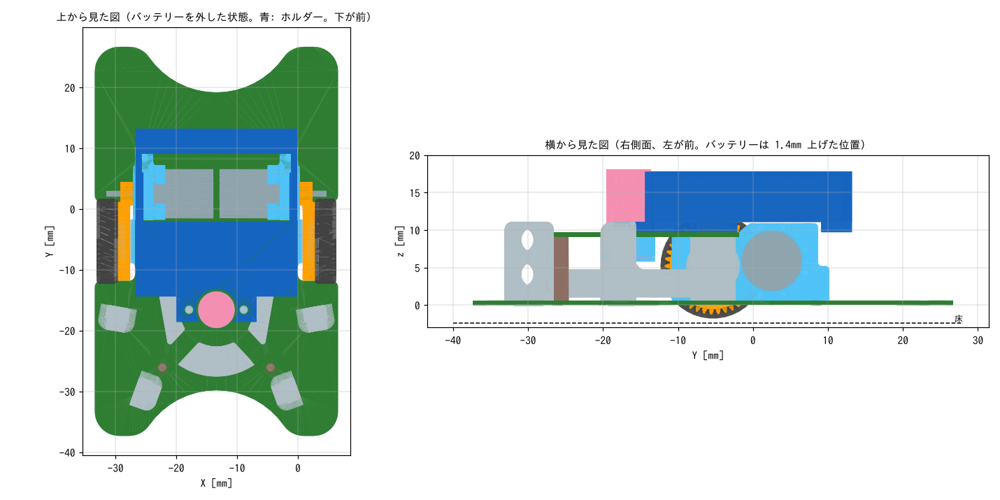

# バッテリーホルダー

上部固定基板の上に載せ、バッテリー（ヤシの木 100mAh、12 × 25 × 6mm）2 本を横に並べて入れる FDM 印刷部品。
吸引ファンモータマウントのネジ 2 本（ファンモータの左右）で、上部固定基板と一緒に留める。

| ファイル | 内容 |
|---|---|
| `battery_holder.py` | 生成スクリプト（CadQuery）。寸法はファイル先頭のパラメータで変える |
| `battery_holder.stl/.step` | バッテリーホルダー |
| `preview.png` | 機体と重ねた確認図 |

STEP は機体の STEP（`mechanical/exported/TORANEKO.Mk3_v36.step`）と同じ座標で出力しているので、Fusion 360 で機体に挿入するとそのまま取り付け位置に来る。

## バッテリーの高さが STEP より 1.4mm 上がる理由

機体の STEP では、バッテリーが上部固定基板の上（基板の下面から 9.7mm）にじかに置かれている。
しかし上部固定基板より後ろでは、**モータマウントの上の出っ張り（10.9mm）とモータ（9.94mm）がバッテリーと重なっている**。
そこでこのホルダーでは、バッテリーの底を 11.1mm（出っ張りの 0.2mm 上）にした。重心は 1.4mm 上がる。

## 形

- 底板は前（上部固定基板の上）と後ろの帯だけ。モータとモータマウントの出っ張りの上は窓にして空けてあり、バッテリーは前後の底板にまたがって載る
- 左右の壁の上端に、バッテリーを上から押さえる 0.3mm のつめがある。上から押し込むと壁が少し開いてはまる
- 前は吸引ファンモータの左右にストッパー、後ろは左右の端だけにストッパーがあり、真ん中は配線を出す口になっている
- 底面には、上部固定基板をモータマウントに留めている既存のネジ 2 本の頭の逃げがある
- 機体の STEP と重ねて確認し、どの部品とも重なっていない（モータマウントの出っ張りと 0.2mm、ファンモータと 0.4mm、41T ギアと 0.9mm）

## 作り方（上から順に）

### 1. バッテリーの寸法を確かめる

1. 実物のバッテリーの幅・長さ・厚さをノギスで測る（保護回路やテープの盛り上がりも含めて、いちばん大きいところ）
2. 12 × 25 × 6mm と違うときは、下の「寸法を変えて作り直すとき」の手順で作り直す

### 2. 印刷する

1. `battery_holder.stl` をスライサーに読み込む。向きはそのまま（平らな底面が下）
2. 材料は PETG がおすすめ（つめで壁を曲げるため。PLA だと割れることがある）。積層 0.2mm、壁 3 周、サポートなし
   - 底板の窓の上を、左右の壁が約 11mm 橋渡しになる。ブリッジ設定が有効になっていることを確かめる

### 3. 取り付ける

1. 吸引ファンモータマウントを上部固定基板に留めているネジ 2 本（ファンモータの左右）を、**1mm 長い M1.4 ネジ**に替える（今 M1.4 × 3 なら M1.4 × 4）
2. ホルダーの丸い穴にファンモータを通し、上部固定基板の上に置く。前後の向きは、ネジ穴の付いた板が前（ファンモータ側）
3. 2 本のネジでホルダーと上部固定基板を一緒に締める

### 4. バッテリーを入れる

1. 配線が後ろの口から出る向きで、バッテリーを上から押し込む。つめを越えると「パチッ」とはまる
2. 外すときは、壁を少し外側に開きながら持ち上げる
3. ゆるいときは、底に薄い両面テープを貼る

## 寸法を変えて作り直すとき

1. `pip install cadquery` で CadQuery を入れる（一度だけ）
2. `battery_holder.py` の先頭の「調整用パラメータ」を書き換える。よく変えるもの:
   - `BATT_W`、`BATT_L`、`BATT_T`: バッテリーの幅・長さ・厚さ
   - `CLEARANCE`: バッテリーと壁のすきま。きつい・ゆるいときに変える
   - `SNAP`: つめの出っ張り。0 にするとつめ無し（テープで押さえる）
3. このディレクトリで `python3 battery_holder.py` を実行する。STL と STEP が上書きされる
