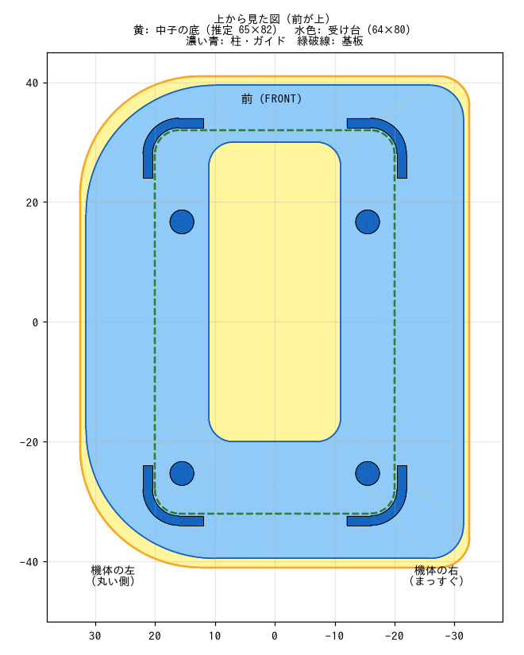

# ケース用の受け台（お弁当箱の中子に入れる）

機体を入れて運ぶお弁当箱（学研ステイフル 11ぴきのねこ ランチボックス 気球 K14503）の中子（中の小さい箱）の底に置き、機体を動かないように納める台（FDM 印刷）。

- 4 本の柱で基板の裏を支える。タイヤは浮くので、機体の重さはタイヤにかからない
- 四隅の L 字のガイドで、機体が前後左右にずれない
- スカート枠・スライダーはどこにも触れない（板の真ん中を抜いてある）ので、運ぶあいだに変形しない

| ファイル | 内容 |
|---|---|
| `case_insert.py` | 生成スクリプト（CadQuery）。中子の寸法はファイル先頭のパラメータで変える |
| `case_insert.stl/.step` | 受け台 |
| `preview.png` | 上から見た図（中子の底の推定・受け台・基板） |

## 中子の寸法は写真からの推定

中子に機体を入れた写真を、基板（40 × 64mm）を物差しにして測った値（誤差 ±3〜5mm）で作ってある。
中子の底は D 字型で、機体の左側（前を上にして見たとき）の 2 つの角が大きく丸く、右側の 2 つは小さい。
誤差を見込んで、測った値より少し小さめにしてある。

| パラメータ | 値 | 写真から測った値 |
|---|---|---|
| `BOX_BOTTOM_L` | 80mm | 底の長さ 約 82mm |
| `BOX_BOTTOM_W` | 64mm | 底の幅 約 65mm |
| `BOX_CORNER_R_LEFT` | 22mm | 左（丸い側）の角 約 R20 |
| `BOX_CORNER_R_RIGHT` | 6mm | 右（まっすぐな側）の角 約 R5 |
| `BOX_DEPTH` | 27mm | 写真では測れない（前の推定のまま） |

この値のとき、機体（ガイドを含む）と中子の壁の余裕は、左右が片側 10.0mm、前後が片側 6.0mm、丸い角が 2.0mm。機体のいちばん上（吸引ファンモータ）は、中子の上の縁より 3.0mm 下になる（深さが推定のままなので要確認）。

受け台は D 字型なので、中子に入る向きは 1 通り（丸い側が機体の左）。もう片方の中子が左右逆の形なら、そちら用は `BOX_CORNER_R_LEFT` と `BOX_CORNER_R_RIGHT` を入れ替えて作る。

**実物を測ったら、この寸法を書き換えて作り直す。**

## 寸法を測って作り直す（上から順に）

1. 中子の内側を、ノギスか定規で測る
   - 底のところの長さ（長いほう）→ `BOX_BOTTOM_L`
   - 底のところの幅（短いほう）→ `BOX_BOTTOM_W`
   - 底の角の丸みの半径（だいたいでよい）→ 丸い側を `BOX_CORNER_R_LEFT`、まっすぐな側を `BOX_CORNER_R_RIGHT`
   - 深さ（底から上の縁まで）→ `BOX_DEPTH`
2. `pip install cadquery` で CadQuery を入れる（一度だけ）
3. `case_insert.py` の先頭の「中子の寸法」の 5 つを書き換える
4. このディレクトリで `python3 case_insert.py` を実行する。STL と STEP が上書きされ、左右・前後・角・上の余裕が表示される
   - どれかがマイナスなら、機体が中子に入らない（上の余裕がマイナスなら、ふたに当たるかを確かめる）

## 作り方・使い方（上から順に）

1. `case_insert.stl` をスライサーに読み込む。向きはそのまま（平らな底面が下）
2. 材料は PLA でよい。積層 0.2mm、サポートなし
3. まず受け台だけを、丸い側を中子の丸い側に合わせて中子に入れ、底にぴったり入るか（ガタが大きすぎないか、きつくないか）を確かめる。合わなければ上の手順で寸法を直す
4. 受け台を中子の底に置き、機体を、前を「FRONT」の側に向けて、上から四隅のガイドの内側に置く
5. 横から見て、左右のタイヤが受け台に触れていないことを確かめる

## 形

- 板: 中子の底の形（推定、D 字型）より片側 0.5mm 小さい、厚さ 2mm。真ん中（スカート枠の下）を幅 22mm × 長さ 50mm 抜いてある
- 柱: φ4、板の上面から 3.86mm。メンテナンス用スタンドと同じ 4 か所で基板の裏を支える。基板の裏に出ている部品（センサのリード、コネクタのピン、スカート枠、スライダー、タイヤ）から離れている
- タイヤと板のすきま: 1.5mm
- ガイド: 基板の外形から 0.4mm 外側、厚さ 1.6mm、長さ 8mm の L 字。上端は基板の上面より 0.4mm 上
- 機体の STEP と重ねて確認し、どの部品とも重なっていない
