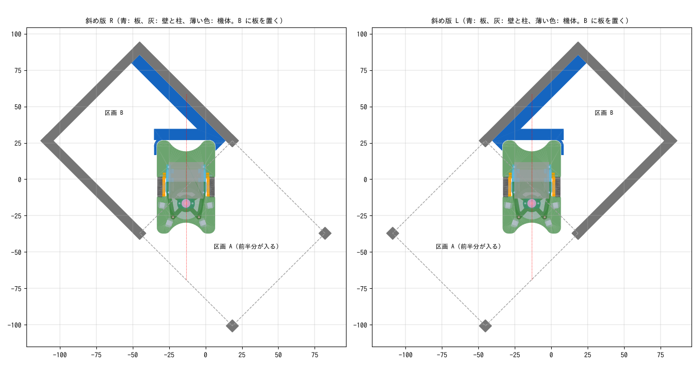

# センタリング板

機体を区画の決まった位置・向きに置くための板（FDM 印刷）。まっすぐ版と斜め版がある。
どれも区画の床に置き、壁に当てる。機体の後ろの 2 つの角を L 字の縁で受けて、機体の中心（車軸の中点）の位置と向きを決める。
位置決めに要るところだけを残した細い枠の形にしてある（まっすぐ版は後ろの帯だけ、斜め版は 2 本の棒）。

**機体の前には何もないので、板を置いたまま機体をスタートさせられる。** 直進・ターンの調整や、壁センサの基準値を測るときに使う。

| ファイル | 内容 |
|---|---|
| `centering_plate.py` | 生成スクリプト（CadQuery）。3 枚とも作る。寸法はファイル先頭のパラメータで変える |
| `centering_plate.stl/.step` | まっすぐ版。機体の中心を区画の中心に、まっすぐ前向きに置く |
| `centering_plate_diag_R.stl/.step` | 斜め版・右。機体の中心を区画の辺の中点に、右斜め 45° 向きに置く |
| `centering_plate_diag_L.stl/.step` | 斜め版・左。右と左右反対で、左斜め 45° 向きに置く |
| `preview.png`、`preview_diag.png` | 機体・区画の壁と重ねた確認図 |

## まっすぐ版

### 形

- 機体の後ろと後ろの壁のあいだ（約 9.4mm）に入る、長さ 83.4mm・厚さ 3mm の帯。ハーフサイズの区画（区画 90mm − 壁 6mm = 壁と壁のあいだ 84mm）に、片側 0.3mm のすきまで入る
- 帯の背中が後ろの壁に、両端が左右の壁に当たって、位置と向きが決まる
- 基板の後ろの 2 つの角を、L 字の縁（幅 1.6mm、床から高さ 4mm、基板から 0.3mm 離す）で受ける。縁は基板の後ろの端と、横の後ろ 10mm だけにある。基板の端は床から 2.36〜2.96mm なので、この縁に当たる
- 機体をまっすぐ前に動かしたときに通る範囲と、板は重ならない（確認済み）。タイヤ・スカート枠・スライダーは基板の外形の内側にあるので、板には乗らない
- 帯の上面の左右に「FRONT」と彫ってある（文字が読める向きが前）

## 斜め版

斜めの動き（斜め入りの終わり、V90、斜め出の始め）は、区画の辺の中点を 45° の向きで通る（ファームウェアの経路もこの考え方で作っている）。
斜め版は、機体の中心をこの「辺の中点」に置き、向きを 45° にする。

### 形

- 3 方に壁がある区画（図の区画 B。スタート区画と同じ形）に置く。壁のない辺の中点に機体の中心が来る
- 形は 2 本の棒をつないだもの（厚さ 3mm）
  - 横の壁に沿う棒（幅 8mm）: 機体の後ろの角の近くから奥の壁まで、横の壁に沿って伸びる。棒が横の壁に沿って当たって向きと左右の位置が、棒の端が奥の壁に当たって前後の位置が決まる
  - 機体の後ろの辺に沿う棒（幅 6mm）: 両端に L 字の縁がある
- 横の壁に沿う棒は、R45 では区画 B の左の壁、L45 では右の壁に沿う（区画 B の中から、壁のない辺のほうを見たとき）
- 機体の後ろ半分は区画 B に、前半分は壁のない辺の向こうの区画（図の区画 A）に入る
  - 基板の角と区画の左右の壁のあいだは 5.2mm。基板が辺を横切る範囲は辺の中点から ±28.3mm で、柱（±42mm より外）に当たらない
- 縁と、前が開いていることは、まっすぐ版と同じ。横の壁に沿う棒の上面に「R」か「L」と彫ってある
- 機体を前（斜め）にまっすぐ動かしたときに通る範囲と、板は重ならない（確認済み）

### 右と左

区画 B の中から、壁のない辺のほうを見たとき:

- **R45**（`centering_plate_diag_R`）: 機体は右斜め前を向く
- **L45**（`centering_plate_diag_L`）: 機体は左斜め前を向く

## 作り方（上から順に）

1. 使う迷路の、壁と壁のあいだの距離を測る。84mm と違うときは、下の「寸法を変えて作り直すとき」の手順で作り直す
2. 使う板の STL（`centering_plate.stl`、`centering_plate_diag_R.stl`、`centering_plate_diag_L.stl`）をスライサーに読み込む。向きはそのまま（平らな底面が下）
3. 材料は PLA でよい。積層 0.2mm、サポートなし

## 使い方（上から順に）

### まっすぐ版

1. 左右と後ろに壁がある区画（スタート区画など）で、帯を後ろの壁に沿わせて置く（「FRONT」の文字が読める向き）
2. 機体を前向きに置き、後ろへ軽く押して、基板の後ろの 2 つの角を L 字の縁に当てる。これで機体の中心が区画の中心に来る
3. そのままスタートさせる。直進や、前に進んでから曲がるターン（スラロームなど）なら、板は置いたままでよい
4. **その場旋回（超信地旋回）をするときは、板を持ち上げて外してからスタートする。** 回ると基板の角が縁に当たるため
5. 壁センサの基準値を測るときも、板は置いたままでよい（縁の高さ 4mm は壁センサの光の高さより低い）

### 斜め版

1. 3 方に壁がある区画（区画 B）と、その壁のない辺の向こうの区画（区画 A）を用意する。機体が斜めに進む先の壁は、調整したい動きに合わせて外しておく
2. 区画 B に板を置く。右斜めに置くなら R45、左斜めなら L45。横の壁に沿う棒を横の壁に沿わせ、その端を奥の壁に押し当てる
3. 機体を斜め向きに置き、後ろへ軽く押して、基板の後ろの 2 つの角を L 字の縁に当てる。これで機体の中心が辺の中点に、向きが 45° になる
4. そのままスタートさせる。斜めの直進・V90・斜め出のように、前に進んでから曲がる動きなら板は置いたままでよい。その場旋回のときだけは板を外す

## 寸法を変えて作り直すとき

1. `pip install cadquery` で CadQuery を入れる（一度だけ）
2. `centering_plate.py` の先頭の「調整用パラメータ」を書き換える。よく変えるもの:
   - `CELL_INNER`: 壁と壁のあいだの距離
   - `WALL_GAP`: 板と壁のすきま。入りにくい・ガタがあるときに変える
   - `BOARD_GAP`: 縁と基板のすきま
3. このディレクトリで `python3 centering_plate.py` を実行する。STL と STEP が上書きされる
