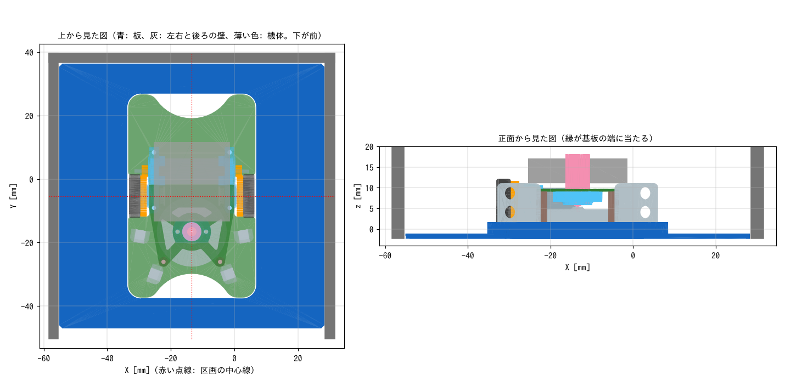

# センタリング板

機体を区画の真ん中に合わせるための板（FDM 印刷）。
区画の床に置くと壁と壁のあいだにちょうど入り、真ん中の機体の形の穴に機体を入れると、機体の中心（車軸の中点）が区画の中心に来る。

- 壁センサの基準値を測るとき（左右の壁からちょうど同じ距離に置きたいとき）
- スタート区画に機体をまっすぐ置くとき

に使う。

| ファイル | 内容 |
|---|---|
| `centering_plate.py` | 生成スクリプト（CadQuery）。寸法はファイル先頭のパラメータで変える |
| `centering_plate.stl/.step` | センタリング板 |
| `preview.png` | 機体・区画の壁と重ねた確認図 |

## 形

- 板は 83.4mm 角、厚さ 1.2mm。ハーフサイズの区画（区画 90mm − 壁 6mm = 壁と壁のあいだ 84mm）に、片側 0.3mm のすきまで入る
- 真ん中の穴は基板の外形（40 × 64mm、四隅 R4）より片側 0.3mm 大きい。穴のまわりの縁（幅 1.6mm、床から高さ 4mm）が基板の端（床から 2.36〜2.96mm）に当たって、機体の位置が決まる
- 機体の中心は、基板の外形の中心と同じ（車軸の中点）
- タイヤ・スカート枠・スライダーはどれも基板の外形の内側にあるので、穴の中で床に付く。縁とタイヤのすきまは 0.6mm
- 上面に「FRONT」と、区画の中心線（左右・後ろ）に合う線を彫ってある

## 作り方（上から順に）

1. 使う迷路の、壁と壁のあいだの距離を測る。84mm と違うときは、下の「寸法を変えて作り直すとき」の手順で作り直す
2. `centering_plate.stl` をスライサーに読み込む。向きはそのまま（平らな底面が下）
3. 材料は PLA でよい。積層 0.2mm、サポートなし。反りやすいので、ベッドにしっかり密着させる

## 使い方（上から順に）

1. 板を、「FRONT」を機体を向けたい方向にして、区画の床に置く。左右の壁のあいだに入れ、後ろに壁があれば後ろの壁に押し当てる
2. 機体を、前を「FRONT」の側に向けて、上から穴に入れる
3. 壁センサの値を測る・スタートさせるなどの作業をする
4. 走らせるときは、機体を持ち上げて板を外してから、もう一度同じ位置に置く（板は機体のまわりを囲んでいるので、機体を置いたまま引き抜くことはできない）。壁センサの値を測るだけなら、板は置いたままでよい（縁の高さ 4mm は壁センサの光の高さより低い）

## 寸法を変えて作り直すとき

1. `pip install cadquery` で CadQuery を入れる（一度だけ）
2. `centering_plate.py` の先頭の「調整用パラメータ」を書き換える。よく変えるもの:
   - `CELL_INNER`: 壁と壁のあいだの距離
   - `WALL_GAP`: 板と壁のすきま。入りにくい・ガタがあるときに変える
   - `BOARD_GAP`: 縁と基板のすきま
3. このディレクトリで `python3 centering_plate.py` を実行する。STL と STEP が上書きされる
