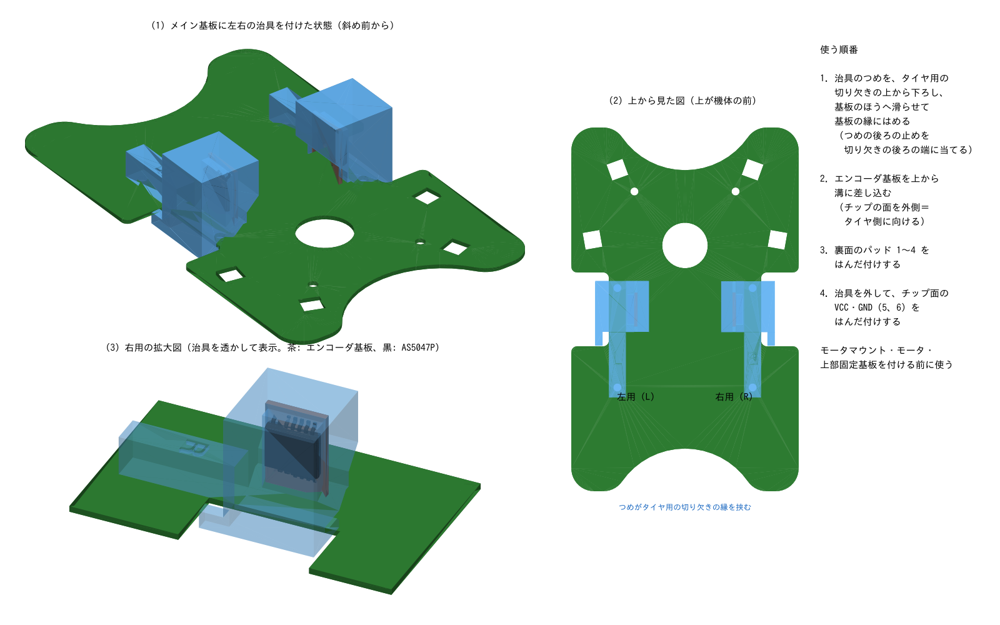
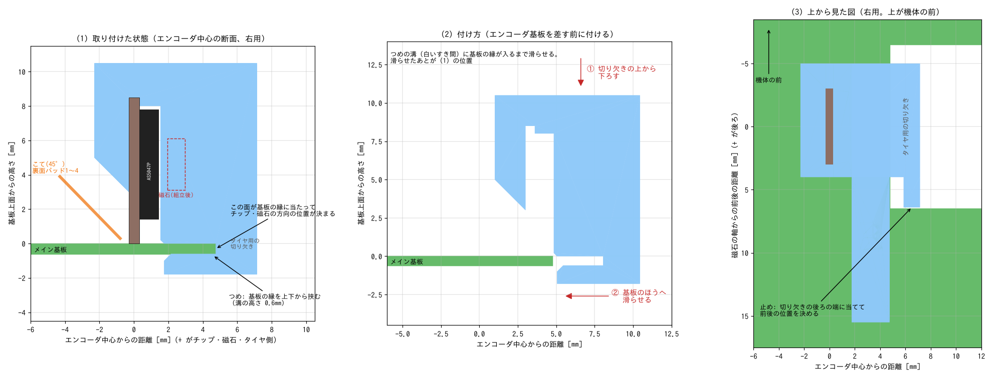

# エンコーダ基板はんだ付け治具

エンコーダ基板（6 × 8.5 × 0.6mm）をメイン基板に垂直に立ててはんだ付けするための 3D プリント治具（FDM）。
**ネジは使わず、メイン基板の縁を挟んで留める。** 治具の外側の面は、タイヤ用の切り欠きの縁（基板の端）とちょうど同じ位置にあり、そこに基板の縁を上下から挟む「つめ」が付いている。
磁石と同じ基準（基板の縁）で位置が決まるので、AS5047P と磁石の位置関係がずれにくい。

| ファイル | 内容 |
|---|---|
| `encoder_solder_jig.py` | 生成スクリプト（CadQuery）。寸法はファイル先頭のパラメータで変える |
| `encoder_jig_L.stl/.step` | 左（U4、x=101.25）用 |
| `encoder_jig_R.stl/.step` | 右（U6、x=118.55）用。L と鏡像 |
| `slot_width_test.stl` | スロット幅テスト片（0.60〜0.85mm） |
| `overview.png`、`section.png` | 全体図、断面・付け方・上から見た図 |

## 保持の仕組み

- **エンコーダ基板**: 上からスロットで挟み、天井で上端を押さえる
  - スロットの幅はエンコーダ基板の厚さと同じ 0.60mm（`SLOT_C = 0`）。テスト片で、いちばん小さい溝（0.60mm）がちょうど固定できたため
  - 裏面は高さ 3〜8.5mm の壁、チップ面は AS5047P の逃げの上端の帯と、基板の両端の帯で受ける
- **メイン基板への留め方**: 治具の外側（チップ・磁石の側）のつめで、タイヤ用の切り欠きの縁を上下から挟む
  - つめの溝の高さはメイン基板の厚さと同じ 0.6mm（`CLAMP_C = 0`）。下あごは基板の下に 3mm 入り込み、先は面取りしてある
  - つめの奥の面が基板の縁に当たって、チップ・磁石の方向（左右）の位置が決まる
  - つめの後ろの端の止めが、切り欠きの後ろの端に当たって、前後の位置が決まる（すきま 0.1mm）
- 位置の基準は基板の縁（タイヤ用の切り欠き）。一方、磁石の位置はモータマウント（ネジ穴が基準）で決まる。そのため、基板の外形の加工誤差のぶんだけ、AS5047P と磁石のすきま（設計 0.5mm）がずれることがある。発注先の外形公差を確かめておく
- 機体の STEP・今の基板（KiCad）と重ねて、付けた状態でも、付ける途中（切り欠きに下ろして滑らせる）でも、基板や部品に当たらないことを確認済み

## 使い方（上から順に）

1. 印刷する。**前の端面（止めがないほうの端面）を下にした横置き**で、サポートなし
   - スライサーで、つめのある側の細い端面ではなく、エンコーダ基板が立つ部分の前の端面が下になるように回す（図の (3) で上側の端）
   - 材料は PLA でよい。積層 0.2mm
2. 治具を付ける（エンコーダ基板を差す前に）
   1. つめが切り欠きの中に入る位置で、治具を上から下ろす（図の (2) ①）
   2. 基板のほうへ横に滑らせて、つめの溝に基板の縁をはめる（図の (2) ②）
   3. 後ろへ押して、つめの止めを切り欠きの後ろの端に当てる
3. エンコーダ基板を、チップの面を外側（タイヤ側）に向けて、上からスロットに差し込む
4. 裏面のパッド 1〜4 を、こて 45° 前後ではんだ付けする
5. 治具を、付けたときと逆に（前に少しずらしてから外側へ）滑らせて外し、チップ面の VCC/GND パッド（5, 6）をはんだ付けする

モータマウント・モータ・上部固定基板を付ける前に使う（タイヤ用の切り欠きが空いている必要がある）。

## きつい・ゆるいとき

- エンコーダ基板が入らない・ゆるい: `SLOT_C`（スロットの片側すきま）を変える
- 治具がメイン基板にはまらない・ゆるい: `CLAMP_C`（つめの溝のすきま。合計）を変える。きついときは 0.05 くらいずつ増やす
- 変えたら、このディレクトリで `python3 encoder_solder_jig.py` を実行すると、STL と STEP が作り直される（`pip install cadquery` が必要）
