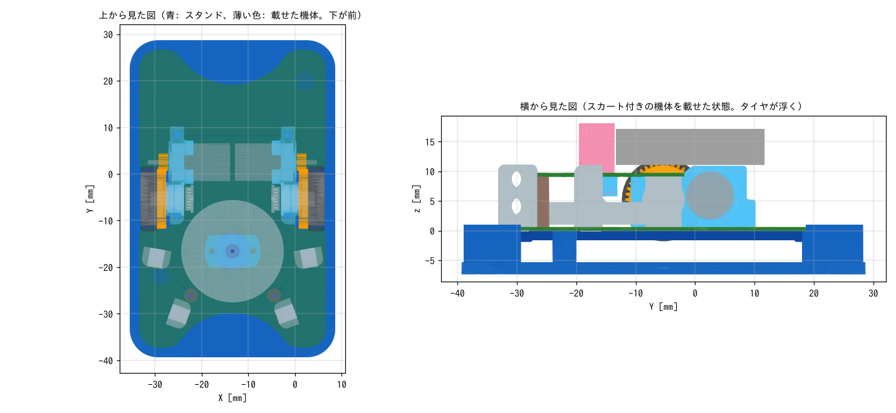

# メンテナンス用スタンド

機体を載せると、タイヤが台から 3mm 浮く台（FDM 印刷）。
モータ・エンコーダ・IMU などの動作確認を、机の上で機体が走り出さずにできる。

| ファイル | 内容 |
|---|---|
| `maintenance_stand.py` | 生成スクリプト（CadQuery）。寸法はファイル先頭のパラメータで変える |
| `maintenance_stand.stl/.step` | スタンド |
| `preview.png` | 機体と重ねた確認図 |

## 形

- 4 本の柱（φ4、台の上面から 5.36mm）で基板の裏を支える。柱が当たる場所は、基板の裏に何も出ていない場所（センサのリード、コネクタのピン、スカート枠、スライダー、タイヤから 1mm 以上離れている）
- スカート枠・スライダーを付けたままでも載せられる（枠とのすきま 3.5mm）
- 四隅の L 字のガイド（基板の外形から 0.4mm 外側）で、載せた機体が前後左右にずれない
- 台の上面の前側に「FRONT」と彫ってある。機体の前（センサのある側）をこちらに向けて載せる

## 作り方・使い方（上から順に）

1. `maintenance_stand.stl` をスライサーに読み込む。向きはそのまま（平らな底面が下）
2. 材料は PLA でよい。積層 0.2mm、サポートなし
3. 機体を、前を「FRONT」の側に向けて、四隅のガイドの内側に上から置く
4. 横から見て、左右のタイヤが台に触れていないことを確かめる

## 寸法を変えて作り直すとき

1. `pip install cadquery` で CadQuery を入れる（一度だけ）
2. `maintenance_stand.py` の先頭の「調整用パラメータ」を書き換える（`TIRE_LIFT`: タイヤを浮かせる高さ、`GUIDE_GAP`: ガイドと基板のすきま）
3. このディレクトリで `python3 maintenance_stand.py` を実行する。STL と STEP が上書きされる
