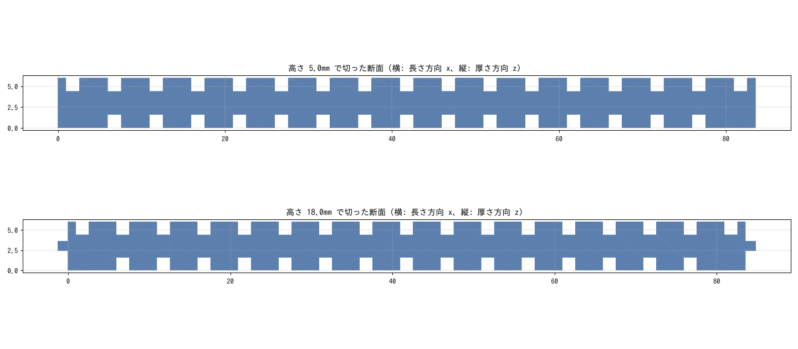

# mechanical/maze/

迷路の部品の 3D データを置いています。

## MicroMouseRefWall_1.step（位置を変えられる壁を作るための壁）

作者が Fusion 360 で作った、ハーフサイズ迷路の壁の形をした部品の STEP（2026-02-03 書き出し、単位 mm）。部品名は「マイクロマウス_柱用途」。

ふつうの壁と同じように柱に差して立てられるうえに、両面に 5mm おきの溝がある。
**2 個を区画の向かい合う壁として立てると、その溝に別の壁の端を差し込んで、壁の位置を 5mm 刻みで変えられる。**
壁センサの値を、壁までの距離を変えて測るときなどに使う。

### 寸法（STEP から測った値）

| 項目 | 値 |
|---|---|
| 大きさ | 86.1 × 25 × 6mm（長さ × 高さ × 厚さ）。ソリッド 1 個（体積 10537mm³） |
| 本体の長さ | 83.6mm（ハーフサイズの柱と柱のあいだ 84mm に、片側 0.2mm のすきまで入る） |
| 端の差し込み | 両端に 1 か所ずつ。厚さ 1.2mm（厚さの真ん中）、長さ 1.2mm、高さ 15mm（壁の高さ 25mm のうち片側の 15mm）。柱の溝に差し込む |
| 溝 | 両面にある。幅 1.6mm、深さ 1.6mm、高さは壁の高さいっぱい。間隔 5mm |
| 溝の位置 | まん中の溝が、壁の長さのちょうど中央にある。片面（STEP の z = 0 側）は中央から ±35mm まで 15 本、もう片面（z = 6 側）は ±40mm まで 17 本 |

溝の幅 1.6mm は、差し込みの厚さ 1.2mm より片側 0.2mm 広い。溝の深さ 1.6mm は、差し込みの長さ 1.2mm より深い。
そのため、この部品どうしなら、片方の差し込みをもう片方の溝にそのまま差し込める。

### 壁の位置の変え方（上から順に）

1. この部品を 2 個、区画の向かい合う 2 か所（たとえば前と後ろ）に、ふつうの壁と同じように差し込んで立てる。溝のある面を区画の内側に向ける
2. 位置を変えたい壁（もう 1 個のこの部品や、端に差し込みのある壁）を、2 個の溝のあいだに渡し、両端の差し込みを、向かい合う同じ番目の溝に上から差し込む
3. 差し込む溝を変えると、壁の位置が 5mm ずつ変わる。区画の中心線からの壁の中心の距離は、0、5、10、…、35mm（z = 6 側の面を内側にすれば 40mm まで）

ふつうの壁の中心は区画の中心線から 45mm（表面は 42mm）なので、たとえば 40mm の溝に差すと、ふつうの壁より 5mm 内側に壁が来る。

### メモ

- 使い方は、作者の説明（「2 個用意すれば壁の位置が調整できる」）と、STEP の形から読み取ったもの
- 差し込みが本体の高さのどちら側の 15mm にあるかは、STEP の向き（y = −25〜−10 の側）だけではわからない。印刷するときは実物の柱と合わせて向きを決める
