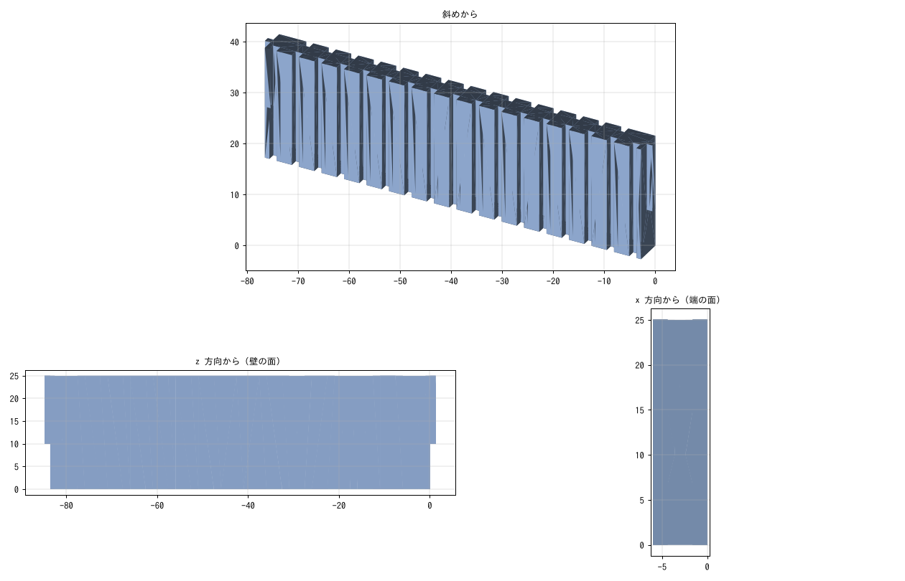

# mechanical/maze/

迷路の部品の 3D データを置いています。

## MicroMouseRefWall_1.step

ハーフサイズ迷路の壁 1 枚の STEP（作者が Fusion 360 で作ったもの。2026-02-03 書き出し、単位 mm）。部品名は「マイクロマウス_柱用途」。

| 項目 | 値 |
|---|---|
| 大きさ | 86.1 × 25 × 6mm（長さ × 高さ × 厚さ） |
| 長さ | 高さ 10mm の部分が 83.6mm。残りの 15mm の部分は、両端が 1.25mm ずつ長い 86.1mm（段になっている） |
| 厚さ | 6mm。両面に縦の溝があり、肉抜きしてある |
| ソリッド | 1 個（体積 10537mm³） |

ハーフサイズの規格（区画 90mm、壁の高さ 25mm・厚さ 6mm、柱と柱のあいだ 84mm）に合う大きさ。
センタリング板などの治具（`mechanical/jigs/`）や壁センサの確認で、壁の形を機体の STEP と重ねて見るときに使う。
