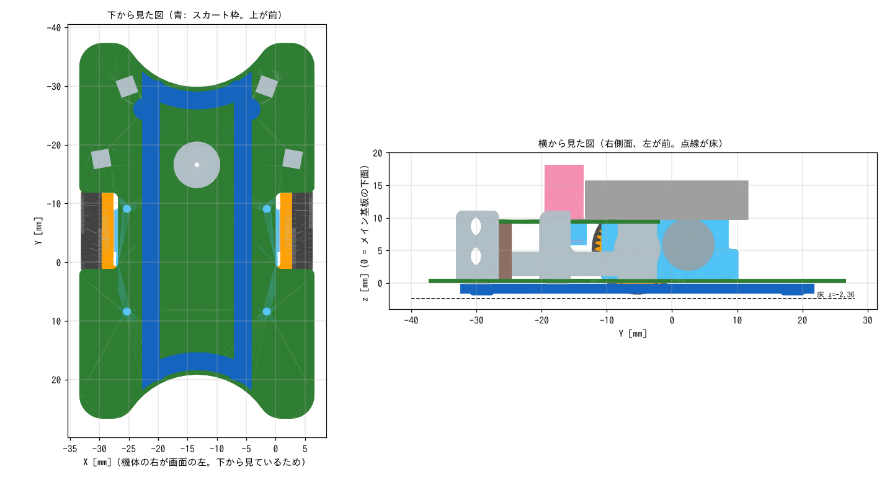

# 吸引ファン用スカート枠・前後のスライダー

基板の裏に付ける FDM 印刷部品。

- **スカート枠**: 吸引ファンの穴（基板の φ8 の穴）のまわりを囲み、基板の裏と床のあいだの空気を吸い出せるようにする枠。前後の端にスライダーの出っ張りも付いている
- **スライダー**: 加減速で機体が前後に傾いたとき、基板の端やセンサホルダより先に床に当たって支える出っ張り。床とのすきまは 0.5mm で、傾きは約 1.2° までに抑えられる

スカートを付けるときは `skirt_frame` だけを使う（スライダーも一体になっている）。スカート枠は**両面テープで基板の裏に貼る**（ネジは使わない）。
吸引ファンを使わないときは、スカート枠と同じ形の前後の端だけを切り出した `slider_front` と `slider_rear` を使う。こちらはネジで留める。

| ファイル | 内容 |
|---|---|
| `skirt_slider.py` | 生成スクリプト（CadQuery）。寸法はファイル先頭のパラメータで変える |
| `skirt_frame.stl/.step` | スカート枠（スライダー付き）。両面テープで貼る |
| `slider_front.stl/.step` | スカートなしで使う前スライダー。支柱のネジ 2 本で留める |
| `slider_rear.stl/.step` | スカートなしで使う後ろスライダー。モータマウントの後ろ側のネジ 2 本で留める |
| `preview.png` | 機体と重ねた確認図 |

STEP は機体の STEP（`mechanical/exported/TORANEKO.Mk3_v36.step`）と同じ座標で出力しているので、Fusion 360 で機体に挿入するとそのまま取り付け位置に来る。
STL は印刷の向き（基板に当たる面が下）に裏返してある。

## 寸法の決め方

- 床はメイン基板の下面から 2.36mm 下（タイヤの下端）
- 枠の下端は基板の下面から 1.6mm（床とのすきま 0.76mm）。両面テープの厚さ 0.15mm の分だけ枠を低く作ってあるので、貼ったときにこの高さになる。壁の厚さは 1.2mm（0.4mm ノズルで 3 周）
- 枠の上面は、両面テープを貼るために外側の面から内側へ 3mm のつばになっている
- 前寄りの 2 か所に、支柱のネジ頭（基板の裏に 0.6mm 出ている）を逃がす穴（φ3.0、深さ 0.8mm）がある。ネジ頭がこの穴に入るので、貼るときの位置決めにもなる
- 枠の外形は、前後が基板のえぐれと同じ中心の円弧（基板の端から 0.8mm 内側）、左右がまっすぐな線
- 左右の幅は、前のセンサホルダ（基板の下に 0.2mm 出ている）とモータマウントのネジ頭をよける幅にした。囲む面積は約 750mm²
- 基板の裏に出ている部品（センサのリード、コネクタ J1・J4・J6 のピン、スライドスイッチの足）からは 1mm 以上離してある
- 機体の STEP と重ねて確認し、どの部品とも重なっていない（基板の下に出ている部品でいちばん近いのは、前のセンサホルダで 0.67mm、41T ギアで 0.87mm）

## 作り方（上から順に）

### 1. 印刷する

1. `skirt_frame.stl`（またはスライダーだけなら `slider_front.stl` と `slider_rear.stl`）をスライサーに読み込む。向きはそのまま（平らな面が下）
2. 材料は PETG がおすすめ（PLA でもよい）。積層 0.2mm、壁 3 周、サポートなし
3. スライダー単体を印刷したときは、ネジ穴に M1.4 のネジが通ることを確かめる。きついときはφ1.6〜1.7 のドリルでさらう

### 2. 両面テープを貼る

1. 薄い両面テープ（厚さ 0.1〜0.15mm 程度）を用意する。パッケージに書いてある厚さが 0.15mm と違うときは、スクリプトの `TAPE_T` を変えて作り直す
2. テープを幅 3mm に細く切る
3. 枠の上面（印刷のとき下だった平らな面）のつばに、一周すきまなく貼る。継ぎ目は重ねずに突き合わせる（重ねると厚くなってすきまができる）
4. 支柱のネジ頭の逃げの穴の上はテープを切り抜く

### 3. 基板に貼る

1. 基板の裏の、枠を貼る範囲をアルコールで拭いて脂を取る
2. 機体を裏返して置き、テープのはく離紙をはがす
3. 前寄りの 2 つの穴に支柱のネジ頭が入る位置に合わせて、枠を基板の裏に当てる。前後の向きは、えぐれた円弧が基板のえぐれに沿う向き
4. 枠を一周、指で押さえて密着させる。横から見て、枠と基板のあいだにすきまがないことを確かめる
5. はがすときは、薄いヘラを枠と基板のあいだに少しずつ入れる

### スカートなしでスライダーだけ付けるとき

`slider_front` と `slider_rear` はネジで留める。次のネジを外して、**1mm 長い M1.4 ネジ**に替えて留める（ネジが通る部分の厚さが 0.8mm のため）。

| ネジ | 本数 | 使う部品 |
|---|---|---|
| 支柱を基板の裏から留めているネジ（機体の前寄り） | 2 | `slider_front` |
| モータマウントを基板の裏から留めているネジ（後ろ側） | 2 | `slider_rear` |

- 今 M1.4 × 3 を使っているなら M1.4 × 4 にする
- モータマウントのネジは **1 本ずつ**外して付け替える（一度に全部外すとモータマウントがずれて、ギアのかみ合わせが変わる）

### 4. 確かめる

1. 機体を平らな床に置き、横から見て、スライダーの出っ張りが床に当たっていない（タイヤだけが床に付いている）ことを確かめる
2. 吸引ファンを回し、機体を持ち上げたときに床に吸い付く感じがあるかを確かめる

### 5. 吸い付きが足りないとき（任意）

枠の下端と床のすきま（0.76mm）から空気が漏れている。すきまを詰めるには、枠の外側の面に薄いテープ（カプトンテープなど）を一周貼り、下に垂らす。

- テープの幅: 約 2.0mm（上端を基板に合わせると、下端が床から約 0.3mm になる）
- テープの長さ: 枠の外周 149mm ＋ 重ね代
- テープは柔らかいので、機体が傾いて床に触れても曲がって逃げる

## 寸法を変えて作り直すとき

1. `pip install cadquery` で CadQuery を入れる（一度だけ）
2. `skirt_slider.py` の先頭の「調整用パラメータ」を書き換える。よく変えるもの:
   - `FLOOR_Z`: タイヤを削って径が変わったら変える（基板の下面からタイヤの下端までの距離にマイナスを付けた値）
   - `FRAME_H`: 枠の高さ。大きくすると床とのすきまが小さくなる
   - `SLIDER_GAP`: スライダーと床のすきま
   - `TAPE_T`: 両面テープの厚さ
3. このディレクトリで `python3 skirt_slider.py` を実行する。STL と STEP が上書きされ、枠の外周の長さが表示される
